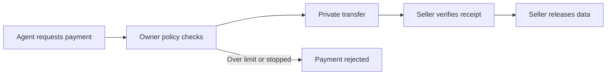
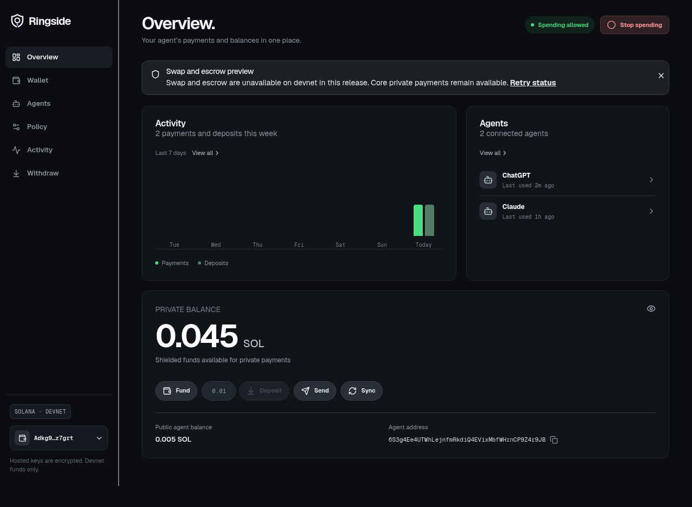

<p align="center"><picture><source media="(prefers-color-scheme: dark)" srcset="brand/logo-dark.svg" /></picture></p>

<h1 align="center">Private payments for agents.<br />Controls for owners.</h1>

<p align="center">Give an AI agent a small payment budget. It can pay a seller privately; you set the limits, see what happened, and stop new payments from your wallet.</p>

<p align="center"><a href="https://ringside.ghoste.trade/demo">Try the demo</a> · <a href="https://ringside.ghoste.trade/app">Open the dashboard</a> · <a href="https://ringside.ghoste.trade/docs">Read the docs</a></p>

Ringside is an MCP server built on Helius Privacy for **Solana devnet**. It works as a hosted connector for ChatGPT and other MCP clients, or as a self-hosted server whose agent key stays on your machine. Use devnet test SOL only.

## Try it in an AI app

1. Add a custom MCP connector in ChatGPT or a supported Claude client. Paste **`https://ringside.ghoste.trade/mcp`**. [Connector instructions](https://ringside.ghoste.trade/onboard) walk through both apps.
2. Connect Phantom and sign in with your owner wallet. Ringside creates a separate agent wallet for hosted use.
3. [Open the dashboard](https://ringside.ghoste.trade/app), fund the agent wallet with devnet SOL, and wait for auto-shield to register and deposit it. The dashboard can prepare a 0.05 SOL funding transfer for Phantom to sign.
4. Ask your agent to check `wallet_info`, then send a small private payment to a **registered** recipient. Review the recipient address and amount when your AI app asks for tool permission.

No local installation or Helius API key is needed for hosted use. Hosted agent keys are encrypted on Ringside's server. Owner policy changes require your wallet signature; the agent cannot raise its own limits. Default limits are **0.05 SOL per payment** and **0.2 SOL per rolling day**.

> Want to see the flow before connecting anything? The [guided demo](https://ringside.ghoste.trade/demo) shows the policy check, private payment, seller verification, and what the public explorer reveals. It labels recorded data when live proof services are unavailable.

## What happens when an agent pays?



The agent can use MCP tools to inspect its wallet, deposit, send, withdraw, and read history. A seller can create a payment request and verify a receipt before serving a paid API response. The owner dashboard shows balances, activity, connected clients, spending rules, and a kill switch. **Auto-shield** moves newly funded hosted SOL into the private balance while leaving a public fee reserve.



*Dashboard image uses example data; it is not a live account balance.*

## What is private?

| Action | Public on Solana | Hidden in a default private transfer |
| --- | --- | --- |
| Fund or deposit | Wallet, amount, asset | — |
| Private payment | Wallets, signature, timing | Amount and asset |
| Withdraw | Recipient, amount, asset | — |

**Funding and withdrawals are public.** Visible wallets and timing can still reveal patterns. Ringside blocks mainnet RPC URLs, rejects unregistered private recipients, and never falls back to a public payment without an explicit withdrawal. Hosted mode holds an encrypted agent key; self-hosted mode keeps it local. [Read the security model](docs/security.md).

## Self-host (advanced)

Run the stdio MCP server with Node 24+, pnpm 11, and your own Helius devnet API key:

```bash
git clone --recurse-submodules https://github.com/mayorXBT/Ringside-MCP.git
cd Ringside-MCP
pnpm install --frozen-lockfile
pnpm build
HELIUS_API_KEY=your-devnet-key node packages/mcp/dist/index.js init --owner YOUR_OWNER_WALLET_ADDRESS
```

Fund the printed agent address with devnet SOL. Keep the generated keypair outside Git with file mode `600`. [The self-host guide](https://ringside.ghoste.trade/docs#self-host) covers MCP client configuration, local pairing, and owner controls.

## Current release

Registration, deposit, private SOL transfer, seller verification, withdrawal, hosted auto-shield, and signed owner controls have been exercised on devnet. ChatGPT custom-connector OAuth with Phantom has been verified. **Swap and escrow are roadmap features**; their discoverable tools currently return `ENGINE_UNAVAILABLE`. Claude account-side payments, USDC, and the escrow bounty demo remain acceptance checks.

For transaction signatures and open checks, see [STATUS.md](STATUS.md). For repeatable demo steps, see [scripts/demo.md](scripts/demo.md). The project brief is in [PRD.md](PRD.md). MIT licensed.
