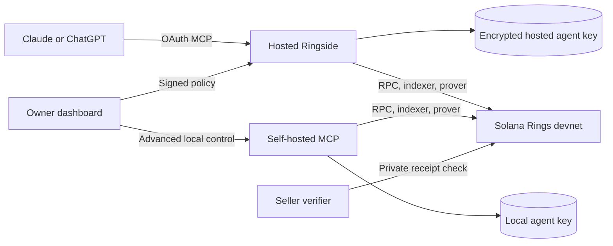

# Ringside MCP

**Private payments for agents. Controls for owners.**

Private agent payments on Solana Rings, with owner spending controls and seller verification. The hosted MCP connector and owner dashboard are live on **Solana devnet**. Hosted signup creates an encrypted agent wallet; self-hosting keeps the agent key on your machine. Real devnet registration, deposit, private transfer, withdrawal, auto-shield, and seller verification have passed. Use test funds only.


[Mobile landing screenshot](docs/landing-mobile.png)


[Mobile dashboard visual fixture](screenshots/app-overview-390.png) · Screenshot balances and clients are mocked for layout checks, not live account data.

[Web documentation](https://ringside-dashboard.vercel.app/docs) · [PRD](PRD.md) · [Build status](STATUS.md) · [Reproducible demo steps](scripts/demo.md) · [Security model](docs/security.md)

## Try it

1. In Claude or ChatGPT, add a custom MCP connector and paste `https://ringside-dashboard.vercel.app/mcp`. [Step-by-step setup](https://ringside-dashboard.vercel.app/onboard) is available for both apps.
2. Sign in with Phantom using your **devnet** owner wallet. On mobile, the flow opens in Phantom and returns the OAuth completion to the original connector tab.
3. Open the [owner dashboard](https://ringside-dashboard.vercel.app/app), copy your agent wallet address, and fund it with devnet SOL. The dashboard can build a 0.05 SOL funding transfer for Phantom to sign.
4. Auto-shield (on by default) registers the agent wallet and deposits available SOL into its private balance, leaving a 0.005 SOL public fee reserve. Once the balance appears, ask your agent for `wallet_info` and then a small private payment to a registered recipient.

Hosted mode holds the agent key encrypted server-side. The owner signs policy changes; the agent cannot raise its own limits. The default caps are 0.05 SOL per payment and 0.2 SOL per rolling day. Funding, deposits, and withdrawals are public on-chain; private transfers hide amount and asset. ChatGPT custom connector OAuth with Phantom login has been accepted, and the cross-browser mobile handoff has been verified. Claude uses the same MCP URL; a Claude account-side payment is still a separate acceptance check.

## Install and connect

### Hosted connector

Hosted signup is enabled on devnet. The public `/mcp` endpoint uses OAuth with Sign-In with Solana and PKCE. The [dashboard](https://ringside-dashboard.vercel.app/app) shares the owner's hosted session, shows balances and activity, and provides signed spending controls. No local server, pairing token, or Helius key is needed for hosted use.

### Self-host (advanced)

Use Node 24+ and pnpm 11. Clone and build:

```bash
git clone --recurse-submodules https://github.com/mayorXBT/Ringside-MCP.git
cd Ringside-MCP
pnpm install --frozen-lockfile
pnpm build
export HELIUS_API_KEY='your-devnet-key'
node packages/mcp/dist/index.js init --owner YOUR_OWNER_WALLET_ADDRESS
```

`init` prints a new agent address. Fund that **dedicated hot wallet** with devnet SOL before using spend tools. The owner wallet signs policy changes and never needs to be the agent fee payer. To use an existing funded Solana CLI keypair without copying it, run `RINGSIDE_KEYPAIR=/absolute/path/agent.json node packages/mcp/dist/index.js init --owner YOUR_OWNER_WALLET_ADDRESS --keypair /absolute/path/agent.json`. The key file must be mode 600 and stay outside Git.

Claude Desktop MCP config (replace both paths and the API key):

```json
{
  "mcpServers": {
    "ringside": {
      "command": "node",
      "args": ["--use-env-proxy", "/absolute/path/Ringside-MCP/packages/mcp/dist/index.js"],
      "env": {
        "HELIUS_API_KEY": "your-devnet-key",
        "RINGSIDE_KEYPAIR": "/absolute/path/agent.json"
      }
    }
  }
}
```

Use the same stdio command and environment in Claude Code or Cursor. `RINGSIDE_HOME` defaults to `~/.ringside`; keep it the same for the MCP process, CLI, seller API profile, and dashboard control API. The server is built from source today; `npx ringside-mcp` is not published yet.

## What is working

| Area | Tools and outcome |
|---|---|
| Wallet | `wallet_info`, `register_private_wallet` / `create_private_wallet`, `deposit`, `sync_balance` / `get_private_balance`, `read_history` / `get_private_history` |
| Spend | `private_transfer`, `withdraw`, `create_test_token`, `deposit_with_interface_setup` |
| Owner policy | `get_policy`; per-transaction, session, and rolling-24-hour caps, allowlists, read-only mode, kill switch; owner-signed writes through the hosted dashboard or self-hosted control API |
| Seller | `create_payment_request`, `pay_payment_request`, `verify_payment`; the deployed demo seller verified a real devnet private SOL payment and rejected replay. A localnet `/report` API also returned 402 before payment, then 200 after verification. |
| Swap and escrow roadmap | Nine discoverable preview tools currently return `ENGINE_UNAVAILABLE` (Ringside engine Tier C). Upstream localnet program tests passed, but Ringside has not enabled these spend paths. Do not lock funds with them. |

The core SOL registration → deposit → private transfer → seller verification → withdrawal loop passed on devnet. Auto-shield also registered and deposited a fresh hosted wallet on devnet, and a hosted OAuth MCP test client made a real private payment. SPL interface deposit and withdrawal, plus a one-unit seller payment, passed with a six-decimal local test token. [STATUS.md](STATUS.md) records signatures and remaining acceptance checks. `RINGSIDE_RUN_LIVE_TRANSFER=1 pnpm check:m1:04` reruns the guarded buyer-to-seller devnet transfer and withdrawal without making a new deposit. `RINGSIDE_NETWORK=localnet` selects the services started by `zolana dev start` on ports 8899, 8784, and 3001. [The demo runbook](scripts/demo.md) gives exact seed, seller API, MCP, and dashboard commands.

## Owner dashboard

[Open the live devnet dashboard](https://ringside-dashboard.vercel.app/app), or run `pnpm --dir apps/dashboard dev`. The hosted `/app` uses a dark shadcn/ui workspace and the same Phantom owner session as connector sign-in. It shows the private balance, public agent balance, auto-shield setup, connected agents, activity, signed policy controls, and a kill switch. Select **Self-host (advanced)** to pair a local agent with the token printed by `RINGSIDE_HOME=/path/to/buyer-home node packages/mcp/dist/index.js pair`. The self-hosted dashboard reads the agent at `127.0.0.1:7420`, displays private balances and history, and lets the owner wallet sign policy, kill-switch, deposit, and withdrawal actions. The `/app/audit` route (also reachable from `/audit`) is a read-only fallback using the local control API. Browser-side viewing-key decryption remains unverified. A hosted page may need Chrome for HTTPS-to-localhost access; include its exact origin in `RINGSIDE_DASHBOARD_ORIGINS` on the MCP process.

## Privacy and safety



For a private transfer, give the agent the exact registered recipient wallet address and check that address in the tool approval. The derived ring address is a separate internal account; an unregistered wallet cannot receive a private transfer.

Default Rings transfers conceal **asset and amount**, while sender, recipient, and transaction signature remain public. Deposits and withdrawals reveal their details on-chain: **funding is public; payments are private**. Hosted agent keys are encrypted server-side; self-hosted keys stay local. The server blocks mainnet URLs, blocks transfers to unregistered recipients, and does not expose a policy-writing MCP tool. Spend tools carry destructive annotations. Swap/escrow example proving keys are insecure test keys and must never be treated as mainnet-ready.

## Comparison

| Approach | Agent interface | Owner controls | Seller receipt check | This release |
|---|---|---|---|---|
| Ringside MCP | Hosted OAuth MCP and self-hosted stdio | Caps, allowlists, signed policy, kill switch | `@ringside/verify` and demo 402 API | Hosted devnet private payment and auto-shield verified; swap/escrow roadmap |
| b402, ZeroK, SNAP, oracle | Existing privacy/payment approaches referenced in the PRD | Varies by project | Varies by project | Direct feature comparison needs a current review of each project |

Ringside combines an MCP payment surface, owner controls, and seller verification. Swap and escrow remain roadmap items at Tier C, not working comparison claims.

## Checks and limits

Run `pnpm check`, `pnpm test`, `pnpm build`, and `cargo test --manifest-path engine/Cargo.toml --locked`. The localnet demo uses `RINGSIDE_SEED_DEMO=1 pnpm seed:demo` and `RINGSIDE_RUN_SELLER_PAYMENT=1 pnpm check:seller`; both flags guard transactions. A Claude Desktop account-side payment, actual USDC transfer and withdrawal, production OAuth client revocation, and the escrow bounty demo remain unverified. See [STATUS.md](STATUS.md) for the current exit checklist.

The repo is MIT licensed. The upstream TypeScript examples are staged at `3d39626853fea338efc802896024cabda39ed4ab`; the PRD's `3069d79` commit was not available from the current remote. The production MCP package now uses `@heliuslabs/zolana@0.4.0-alpha`; the repository also retains a 0.3.1-alpha dependency for compatibility checks.
